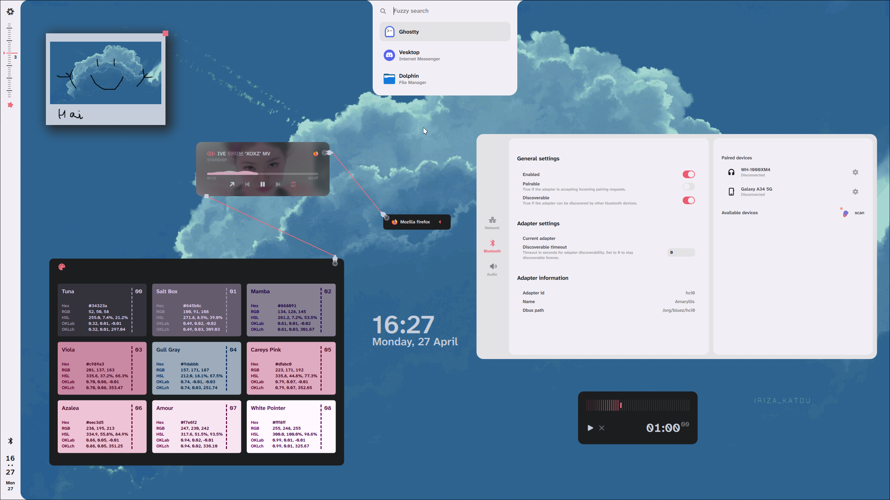

<h2>Greenhouse</h2>

My Nixos configuration 

 

 

> [!TIP]
> Удачи блядь в этой гавне каверяться. Залупа полная

The entry point is [./modules/hosts](modules/hosts)

 

## Credits
+ [Rexcrazy804/Zaphkiel](https://github.com/Rexcrazy804/Zaphkiel)
+ [denful/dendritic-unflake](https://github.com/denful/dendritic-unflake)
+ [dendritic pattern guide](https://github.com/Doc-Steve/dendritic-design-with-flake-parts)
+ [pinning with npins blog by Jade](https://jade.fyi/blog/pinning-nixos-with-npins/)
+ [pinning with npins blog by piegames](https://piegames.de/dumps/pinning-nixos-with-npins-revisited/)
